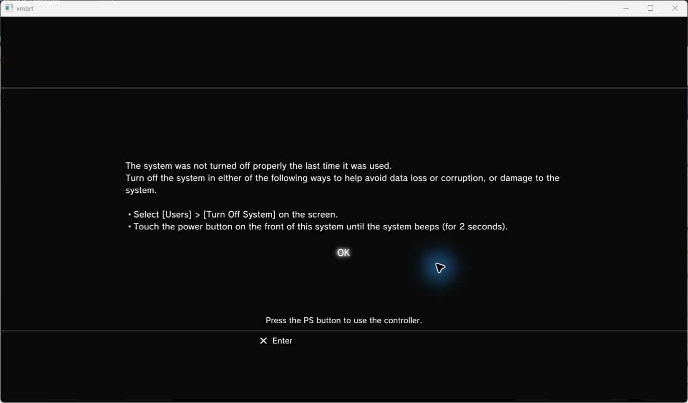
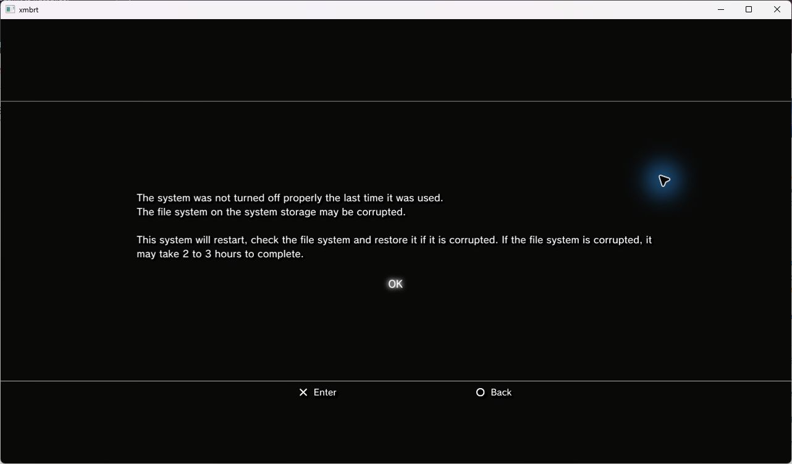
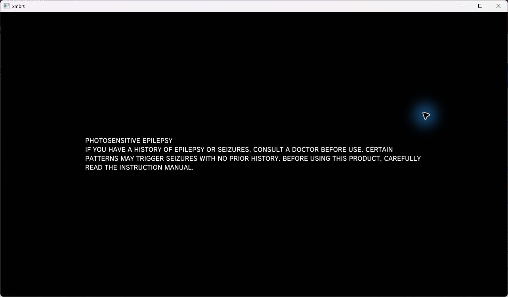
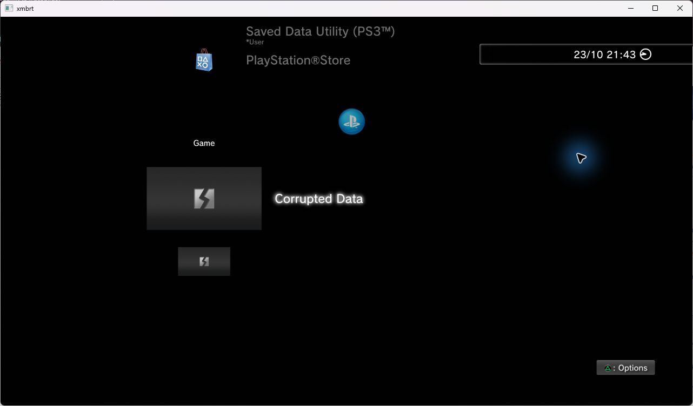
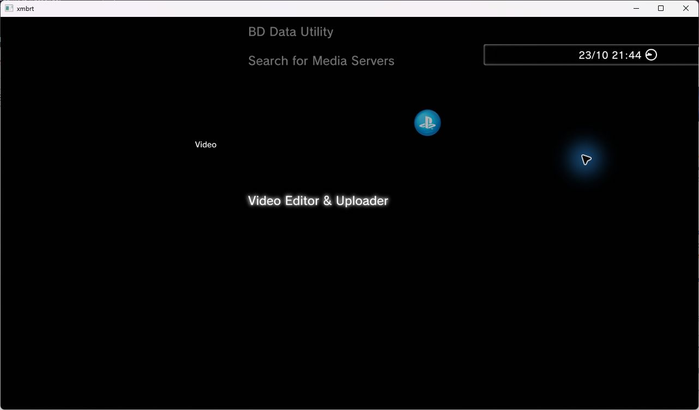
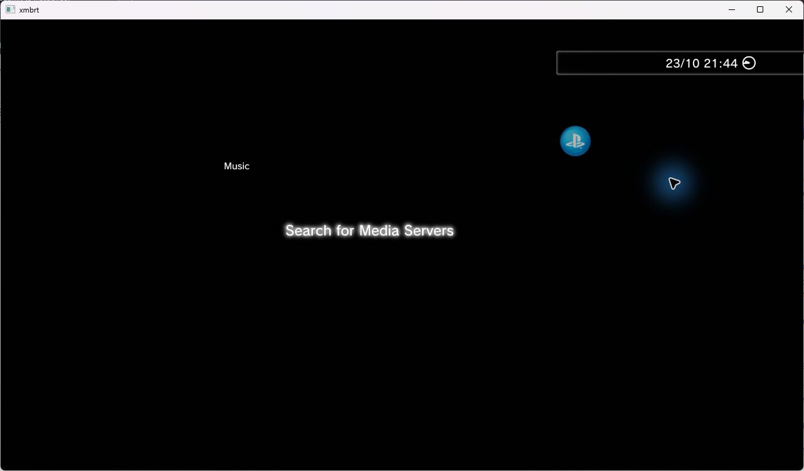
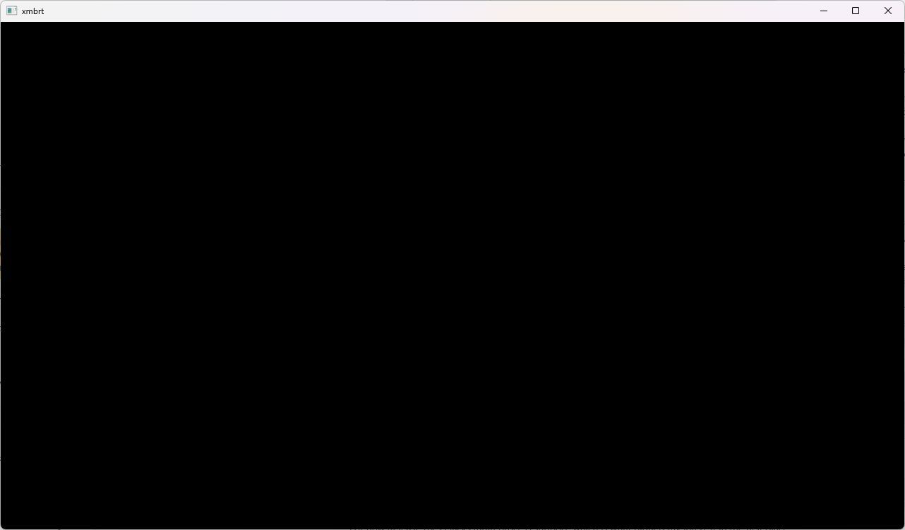
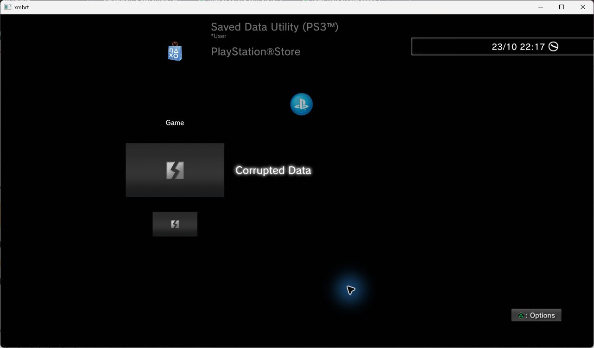
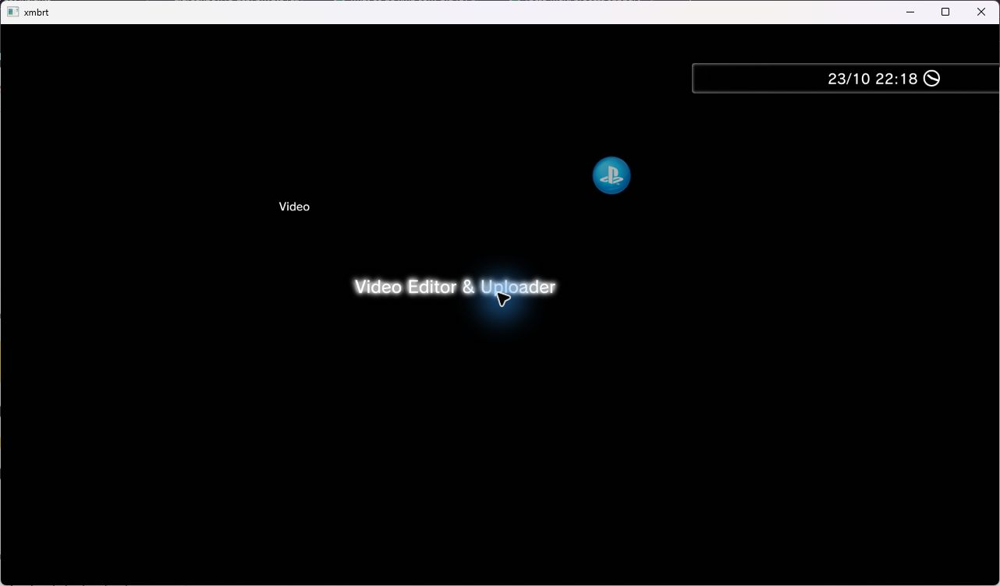
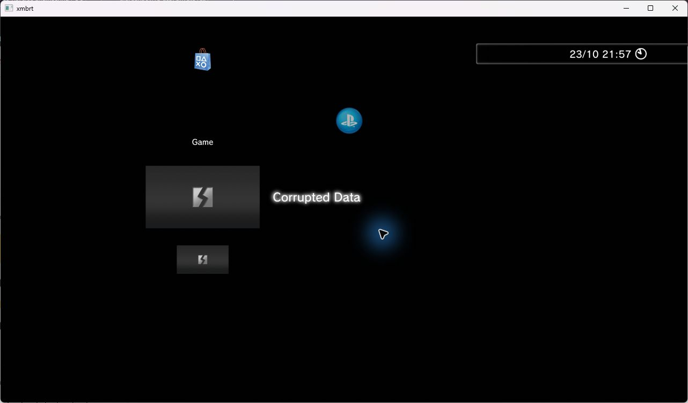

# Native XMB stage screenshots

Captured October 23, 2026 from the native Windows runtime, boot session
`20261023-163845-853`, after the floating-texture upload change. These are original
window captures. Capture metadata is in [manifest.json](screenshots/manifest.json).

## 1. Startup notice

Dirty-shutdown notice before Enter acknowledges it.

## 2. Filesystem recovery prompt

The firmware offers a filesystem check and restart. Escape selected Back after
this capture. This records the prompt, not execution or completion of a rebuild.

## 3. Boot warning

Photosensitivity warning after backing out of the recovery prompt.

## 4. Game menu

The Game category reached its populated list. Corrupted Data was selected; no
delete or repair action was taken. Background/category icons remain incomplete.

## 5. Video menu

One Left press from Game selected Video. Its menu text is visible; the editor
and media playback were not launched.

## 6. Music menu

Another Left press selected Music. This demonstrates category navigation only.

## Limits and next capture

### Branch coverage and per-unit sampling follow-up

Normal session `20261023-171447-817` became black after plugin teardown. F12 recorded
5,755 draws,245 flips and a drained FIFO. This is a failed boot, not a menu capture.

Diagnostic session `20261023-171608-926`, boot1, reached Game and accepted Left to
Video. The clock advanced22:17 ->22:18. Shader compilation/linking logged no error
before the snapshot. Background and category icons remain wrong. These captures
do not establish normal-mode stability or execution of the recovered JPEG branch.

Per-capture metadata: [08](screenshots/08-sampling-black-boot.json),
[09](screenshots/09-sampling-game-menu.json), [10](screenshots/10-sampling-video-menu.json).

### Floating render-target follow-up

Boot1 of session `20261023-165609-569` reached Game after a guest-requested reboot.
The updated renderer observed complete RGBA16F and RGBA32F framebuffer allocations.
The background and category icons remain incorrect; this is the result after that
change, not a claim of visual improvement. [Capture metadata](screenshots/07-float-surfaces-game.json).

The background is black and category icons are incorrect in this build. These
screenshots do not establish exact rendering or long-run stability. Phase 5 media
services and Phase 6 launcher work remain future work; their handoffs define the
evidence to capture as those features are implemented.
